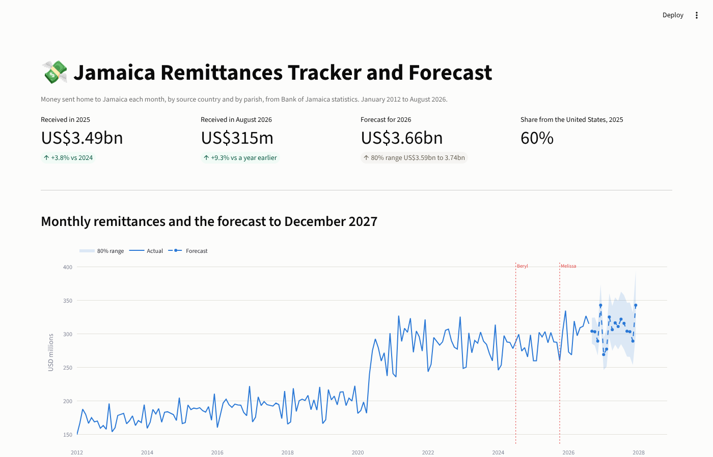

# Jamaica remittances tracker and forecast

[](https://doi.org/10.5281/zenodo.24473012)

Remittances, the money Jamaicans abroad send home, were worth US$3.49 billion in 2025.
They are Jamaica's second biggest source of foreign currency after tourism. This project
tracks them month by month from Bank of Jamaica statistics, breaks them down by source
country and by parish, forecasts them to the end of 2027, and measures what Hurricane
Melissa did to them.

**Live app: https://jamaica-remittances.streamlit.app**

**Working paper:** [Diaspora as Insurance: Remittances and Visitor Arrivals in Jamaica after Hurricane Melissa](https://doi.org/10.5281/zenodo.24473012) ([PDF in this repo](paper/McIntosh_2026_Diaspora_as_Insurance.pdf))



## The short version

| | |
|---|---|
| Months covered | 176, January 2012 to August 2026 (parishes from July 2020) |
| Received in 2025 | US$3.49 billion, a record, up 3.8% on 2024 |
| Biggest source | United States, 60% of the 2025 total |
| Forecast for 2026 | US$3.66 billion (80% range US$3.59bn to US$3.74bn) |
| Forecast for 2027 | US$3.68 billion (80% range US$3.34bn to US$4.10bn) |
| Best model | Exponential smoothing, 2.6% average error one month ahead |

## Four findings

**1. COVID changed the level for good.** Remittances were US$2.41 billion in 2019 and
US$3.50 billion in 2021, 45% higher. They never went back. Likely reasons are families abroad
sending more during the crisis and money moving from informal routes into the formal
channels BOJ can count, but this data cannot separate the two.

**2. Melissa moved the timing more than the total.** In October 2025, the month the storm
hit, money from every main source country came in 10% to 14% below what a model trained
on pre storm data expected. In a normal month that model is off by about 2.3%, so this was
well outside the usual range. In November, money from the US, UK and Canada came in 11%
to 19% above expected. Add October and November together and those three countries were
within 4% of the expected total. The number of transfers jumped 13.7% on a year earlier
while the average transfer stayed around US$300: more people sent money, not bigger amounts.

**3. The money did not land where the damage was.** In November 2025, remittances to
Kingston and St. Andrew were up 28% on a year earlier. The hardest hit western parishes
were flat or down, with Hanover at minus 13.6%. After allowing for each parish's normal level
and for the month, the five western parishes received 15% less than the rest of the island
in November (p < 0.001). By December the gap was gone. One likely reason is that agents and
power were out in the west, so money was collected elsewhere. That needs testing, and it is
the question the companion paper takes up.

**4. A good forecast is only a little better than last year's pattern.** Exponential
smoothing beat the simple "same month last year" rule, with a 2.6% one month error against
4.0%. For the full year ahead the gap is smaller, 1.7% against 2.1%. Remittances follow a
strong calendar: December runs about 12% above an average month and January about 14%
below, which a simple rule already captures.

## How the data was built

The Bank of Jamaica publishes four remittance tables as Excel files: inflows by source
country (ES.RMT.01), outflows (ES.RMT.02), inflows by parish (ES.RMT.03) and the number of
transfers. They were downloaded in November 2026 and saved as CSV in `data/raw/`. Every
table was checked against the sum of every value in the original file, and the annual
totals match published figures (US$3,357.9 million for 2024, about US$3.49 billion for 2025).

Two things to know:

* Country figures cover remittance companies. Money through banks and other routes is
  reported as one "other remittances" line with no country split.
* From 2024 BOJ reports Kingston and St. Andrew together, so they are combined for every
  month here. An earlier BOJ file repeated January 2026 figures in February 2026 for five
  parishes. BOJ revised February after a query in November 2026, and the revised figures
  are used here. BOJ confirms the parish table records where money is paid out.

## How the forecast was tested

A rolling backtest: for every month from January 2023, each model is trained only on the
data available at that point and scored on the next 12 months.

| Model | Next month error | Next 12 months total error |
|---|---|---|
| Exponential smoothing | 2.64% | 1.71% |
| SARIMA | 2.85% | 2.82% |
| Seasonal naive with growth | 3.53% | 2.15% |
| Seasonal naive | 4.04% | 2.08% |

The forecast ranges come from 2,000 simulated future paths, so the annual range is a real
80% range for the year.

## How the hurricane effect was measured

* **By source country:** fit the model on data up to the month before landfall, forecast
  six months, and compare with what arrived. A placebo test runs the same check on every
  normal month from 2022 to show how large a miss usually is (95% are within 5.2%).
* **By parish:** a difference in differences on log remittances, comparing the five western
  parishes with the other eight, with parish and month effects and standard errors
  clustered by parish. With only 13 parishes, treat the p values as a guide.
* **Beryl (July 2024)** is the comparison storm. It left no lasting mark: the total over
  the six months after landfall was within 0.3% of expected.

## Robustness checks

`src/03_robustness.py` reruns the hurricane results four other ways. All four agree.

| Check | Result |
|---|---|
| Damage intensity instead of a west dummy (World Bank GRADE damage as a share of exposed value, by parish) | Each 10 points of damage share meant 6.5% less remittances in November 2025 (p = 0.026). Nothing in other months |
| Wild cluster bootstrap for the west vs rest gap (Webb weights, 9,999 draws, 13 parishes) | Minus 14.9%, p = 0.0035 |
| SARIMA instead of exponential smoothing | October 9% to 12% below expected, November 4% to 20% above; US, UK and Canada within 4% over the two months combined |
| Visitors, against each segment's own pre storm trend | October to December 2025: foreign stopovers 43.6% below expected, non resident Jamaicans 8.7% below. November: minus 72.2% vs minus 9.1% |

The five western parishes used above are also the five with the highest damage share in the
[World Bank GRADE report](https://www.gfdrr.org/en/JamaicaGRADE) (St. Elizabeth 26.3%, Westmoreland
19.2%, St. James 15.4%, Trelawny 12.8%, Hanover 9.4%), so the grouping was not picked after the fact.

## Run it

```bash
pip install -r requirements.txt
python src/01_forecast.py      # backtest and forecast
python src/02_hurricanes.py    # storm analysis
python src/03_robustness.py    # robustness checks and visitors
streamlit run app.py
```

## Project structure

```
app.py                  the Streamlit app
src/model.py            data loading and forecasting models
src/01_forecast.py      backtest and forecast to Dec 2027
src/02_hurricanes.py    Beryl and Melissa analysis, parish difference in differences
src/03_robustness.py    damage intensity, wild bootstrap, SARIMA, visitors
data/raw/               Bank of Jamaica tables, JTB visitors, World Bank damage by parish
outputs/                results used by the app
```

Built by [Devin McIntosh](https://www.linkedin.com/in/devinlerandezmcintosh).

## How to cite

McIntosh, Devin. 2026. "Diaspora as Insurance: Remittances and Visitor Arrivals in Jamaica after Hurricane Melissa." Working paper. Zenodo. https://doi.org/10.5281/zenodo.24473012
