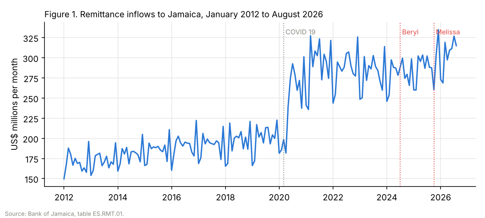
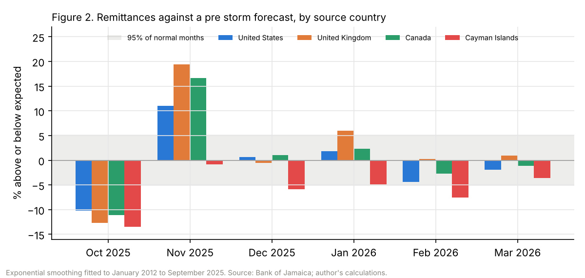
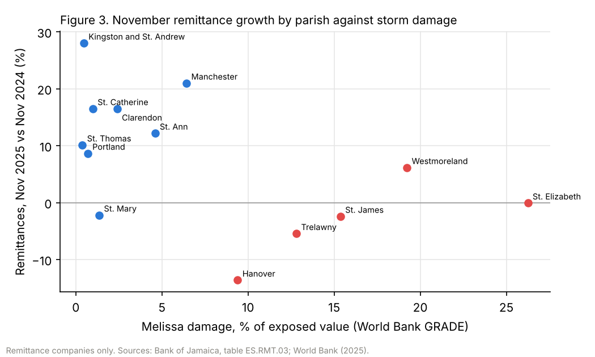
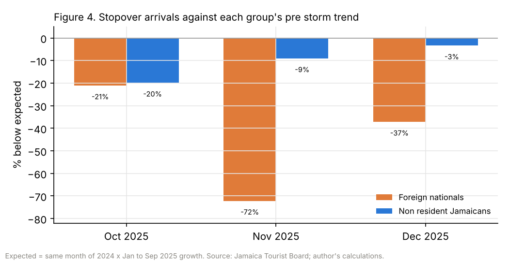

# 1. Introduction

Small island economies carry hurricane risk that is hard to insure through markets. For Jamaica, one of the largest informal insurers is its own diaspora. Jamaicans abroad sent home a record US\$3.49 billion in 2025, and non resident Jamaicans make up a steady share of the island's stopover visitors. A long literature finds that remittances rise after natural disasters (Yang 2008; Mohapatra, Joseph, and Ratha 2012; Bettin and Zazzaro 2018). Much less is known about how fast that support arrives, where inside a country it lands, and whether the diaspora's other link to home, travel, behaves the same way.

Hurricane Melissa offers an unusually clear test. It made landfall near New Hope, Westmoreland, on 28 October 2025 as a Category 5 storm, the strongest on record to strike Jamaica. Total damage, losses and additional costs were estimated at JMD 1,953 billion (US\$12.23 billion) in the government's damage and loss assessment (Bello et al. 2026), and the damage was heavily concentrated in five western and southern parishes (World Bank 2025). Bank of Jamaica publishes remittance inflows by month, by source country and, since July 2020, by parish, so the response can be traced month by month and place by place.

This paper makes three contributions. First, it shows that in Jamaica's case the storm changed the timing of remittances more than their total, in contrast to the steady post disaster rise found in cross country monthly data (Bettin, Jallow, and Zazzaro 2025). Second, it uses parish data to show that the money did not reach the most damaged parishes first. Third, it sets remittances beside visitor arrivals to show that the diaspora also kept travelling when foreign tourists did not. Section 2 gives background, section 3 reviews the literature, sections 4 and 5 describe the data and methods, section 6 presents the results, section 7 tests their robustness, and section 8 discusses policy and concludes.

# 2. Background

**Remittances.** Gross remittance inflows to Jamaica rose from US\$2.04 billion in 2012 to US\$2.41 billion in 2019, then jumped to US\$3.50 billion in 2021 during the COVID 19 period and have stayed near that level since, reaching US\$3.49 billion in 2025 (Bank of Jamaica 2026a). Bank of Jamaica reports that remittances were equal to 15.3% of GDP in 2024 (Bank of Jamaica 2026b). In 2025 the United States supplied 60% of the total, the United Kingdom 10%, Canada 8.5% and the Cayman Islands 5.6%. Remittances are Jamaica's second largest source of foreign exchange after tourism, equal to about 78% of tourist spending in 2024 (Bank of Jamaica 2026b).

**Diaspora tourism.** Non resident Jamaicans accounted for about 8% of stopover arrivals in 2025 (Jamaica Tourist Board 2026). Before Melissa, this segment was already shrinking: arrivals from January to September 2025 were 15.1% lower than a year earlier, while foreign arrivals were 1.1% higher.

**The two storms.** Hurricane Beryl passed close to Jamaica's south coast in July 2024 and caused comparatively limited damage. Hurricane Melissa was far larger. The damage and loss assessment names St. Elizabeth, Westmoreland, Hanover, St. James, Trelawny and St. Ann as the most affected parishes, with Westmoreland, St. Elizabeth and St. James accounting for 91.6% of housing damage and St. James for nearly 44% of tourism damage (Bello et al. 2026). The World Bank's rapid damage estimate puts damage as a share of each parish's exposed value at 26.3% in St. Elizabeth, 19.2% in Westmoreland, 15.4% in St. James, 12.8% in Trelawny and 9.4% in Hanover, against 6.3% for Jamaica as a whole and under 1% in Kingston, St. Andrew, St. Catherine, Portland and St. Thomas (World Bank 2025).

# 3. Literature

**Remittances as disaster insurance.** Yang (2008) builds a storm index from meteorological data and finds that for poorer developing countries hurricanes raise migrants' remittances, so that total inflows over the following three years amount to roughly four fifths of estimated damages; for richer developing countries, offsetting falls in private flows mean full replacement cannot be shown. Mohapatra, Joseph, and Ratha (2012) find that remittances rise after disasters in countries with more migrants abroad, and that remittance receiving households are better prepared beforehand. Bettin and Zazzaro (2018), using a panel of 98 countries from 1990 to 2010, also find that remittances increase after a disaster and that they substitute for weak local financial systems.

**Timing.** Annual data cannot show how quickly support arrives. Bettin, Jallow, and Zazzaro (2025) use monthly remittances from Italy to 81 low and middle income countries between 2005 and 2015 in an event study. They find an immediate rise that stays significant for three to four months, a cumulative increase of about 4% over six months, and no fall below pre disaster levels afterwards. Their sample has no Jamaica specific results, and storms are not analysed on their own.

**Diaspora tourism.** Work on diaspora tourism after disasters is mostly qualitative. Seraphin, Korstanje, and Gowreesunkar (2020) argue, from the case of Haiti, that diaspora tourism benefits post disaster destinations and is less seasonal than international tourism. Jamaica's tourism minister has publicly credited the diaspora with the recovery after Melissa, but to our knowledge no study has measured the diaspora's travel response against foreign visitors with monthly arrivals data.

**This paper's place.** We follow the monthly approach of Bettin, Jallow, and Zazzaro (2025) for a single country and storm, add the within country dimension that parish data make possible, and set remittances beside travel, the two main ways the diaspora connects with home.

# 4. Data

All series are monthly and in US dollars unless noted. Data and code are public at github.com/Soulkinggja/jamaica-remittances.

| Series | Source | Coverage | Notes |
|:--|:--|:--|:--|
| Remittance inflows by source country | Bank of Jamaica, ES.RMT.01 | Jan 2012 to Aug 2026 | Country detail covers remittance companies |
| Number of inbound transfers | Bank of Jamaica, ES.RMT.01 | Jan 2012 to Aug 2026 | Thousands of transfers |
| Remittance inflows by parish | Bank of Jamaica, ES.RMT.03 | Jul 2020 to Aug 2026 | Remittance companies only; Kingston and St. Andrew combined |
| Stopover arrivals by segment | Jamaica Tourist Board | Jan 2023 to Dec 2025 | Foreign nationals and non resident Jamaicans |
| Damage by parish | World Bank GRADE (2025) | Melissa only | Damage as a share of exposed value |

The remittance tables were checked against the sum of every value in the original files, and annual totals match published figures (US\$3,357.9 million for 2024). Two data issues are noted. Parish figures for January and February 2026 repeat exactly for several parishes, which looks like a carried forward value; Bank of Jamaica is being asked to confirm them, and the November results do not depend on those months. The parish table covers remittance companies only, which carry most inflows.

# 5. Methods

**Expected path without the storm.** For each remittance series we fit an exponential smoothing model with additive damped trend and additive seasonality on log values, using only data up to the month before landfall, and forecast the next six months. The storm effect in month $t$ is the percentage gap between what arrived and the forecast:

$$ g_t = 100 \left( \frac{y_t}{\hat{y}_{t \mid T_0}} - 1 \right) $$

where $T_0$ is September 2025 for Melissa and June 2024 for Beryl. The same model had the lowest error in a rolling backtest from January 2023 (2.6% one month ahead, against 4.0% for a seasonal naive rule). To judge whether a gap is unusual, a placebo test computes the same one month gap for every non storm month from January 2022, excluding COVID months: the mean absolute gap is 2.3% and 95% of gaps are within 5.2%.

**Parish difference in differences.** For parish $p$ in month $t$, from January 2022:

$$ \ln R_{pt} = \alpha_p + \delta_t + \sum_{k} \beta_k \, D_p \, \mathbf{1}[t = k] + \varepsilon_{pt} $$

where $R$ is remittances through remittance companies, $\alpha_p$ and $\delta_t$ are parish and month fixed effects, $k$ runs over September 2025 to March 2026, and $D_p$ is either a dummy for the five most damaged parishes or the World Bank damage share in tens of percentage points. Standard errors are clustered by parish; with 13 clusters we also report a wild cluster bootstrap with Webb weights and 9,999 draws.

**Visitors.** Visitor data start in 2023, too short for a seasonal model, so the expected value for each segment in month $t$ is the same month a year earlier scaled by that segment's growth from January to September 2025. This lets each group carry its own pre storm trend.

# 6. Results

## 6.1 Melissa moved the timing of remittances more than the total

Figure 1 shows the long run path of inflows: a step up during COVID 19 that never reversed, strong December peaks and January troughs, and a visible dip in October 2025. Figure 2 compares each main source country with its pre storm forecast. In October 2025, the landfall month, inflows from the United States were 10.2% below expected, the United Kingdom 12.7%, Canada 11.1% and the Cayman Islands 13.5%; total inflows were 9.3% below. All four are well outside the range that covers 95% of normal months. In November the United States came in 11.0% above expected, the United Kingdom 19.4% and Canada 16.6%, again outside the normal range. Inflows from the Cayman Islands did not rebound and stayed 4% to 8% below expected through February 2026.

{width=100%}

Taken together, October and November were close to normal. Combined inflows over the two months were 0.0% from expected for the United States, 1.6% above for Canada and 3.2% above for the United Kingdom. Over six months, total inflows were 3.3% above expected, but that figure is sensitive to the model and to the Cayman Islands corridor and should not be read as a clear increase. The November rise came from more transfers, not larger ones: the number of transfers was 13.7% higher than a year earlier, while the average transfer was US\$303, 0.6% above November 2024.

{width=100%}

Hurricane Beryl left no comparable mark. Over the six months after July 2024, total inflows were within 0.3% of expected.

## 6.2 The money did not reach the hardest hit parishes first

Figure 3 plots each parish's November remittance growth against its storm damage. Kingston and St. Andrew, with damage under 1% of exposed value, received 28.0% more than in November 2024. Hanover received 13.6% less, Trelawny 5.4% less and St. James 2.4% less, and St. Elizabeth, the most damaged parish, was flat. In the difference in differences, the five most damaged parishes received 14.9% less than the rest of the island in November 2025, after parish and month fixed effects (p < 0.001). The estimates for September and October are small and not significant, and by December the gap had fallen to 2.3% and was no longer significant. Using damage share instead of a dummy, each 10 points of damage meant 6.5% less remittances in November (p = 0.026), with no significant effect in any other month.

{width=90%}

One explanation is that remittance agents, banks and power were out of service in the west in November, so money was sent to, or collected by, relatives in less damaged parishes. The data cannot separate these channels, and the parish table records where money was paid out, not where it was spent.

## 6.3 Diaspora visitors held up far better than foreign visitors

Figure 4 compares stopover arrivals with each group's expected path. Foreign arrivals were 21.1% below expected in October, 72.2% below in November and 37.2% below in December, 43.6% below over the quarter. Non resident Jamaican arrivals were 19.9%, 9.1% and 3.4% below expected, 8.7% below over the quarter. The diaspora segment was already shrinking before the storm, so its raw year on year fall (22.9% in November) overstates the storm's effect on it; against its own trend, the storm barely changed it after October.

{width=90%}

# 7. Robustness

The main results survive four checks.

| Check | Result |
|:--|:--|
| SARIMA(1,1,1)(0,1,1)12 in place of exponential smoothing | October 9.1% to 12.2% below expected across corridors; November 4.4% to 20.3% above; US, UK and Canada within 4% over the two months combined |
| Wild cluster bootstrap, Webb weights, 9,999 draws, 13 clusters | November west gap minus 14.9%, p = 0.0035 (cluster robust p = 0.0001) |
| Damage share from World Bank GRADE in place of the west dummy | Minus 6.5% per 10 points of damage in November, p = 0.026; no other month significant |
| Placebo forecast gaps, 43 normal months since 2022 | Mean absolute gap 2.3%; 95% within 5.2%; largest 8.8% |

The five parishes in the west dummy are also the five with the highest damage share in the World Bank estimate, so the grouping was not chosen after seeing the results. Two limits remain. The parish panel has only 13 units, and parish data cover remittance companies only. A fuller test would add Hurricane Beryl at parish level, which is not possible because Beryl's damage was too limited to define a treated group.

# 8. Policy discussion and conclusion

The Jamaican diaspora behaved like an insurer after Hurricane Melissa, but a slow one. Its members sent money as soon as they could and kept visiting, yet the money arrived a month late and reached the least damaged parts of the island first. Three policy lessons follow.

1. **Keep the payout network running.** The October dip and the November parish gap point to the last mile, not to the willingness of senders. Backup power and connectivity for remittance agents in high risk parishes, temporary mobile payout points after a storm, and faster use of mobile wallets could bring the insurance forward by weeks, when households need it most.
2. **Track remittances by parish in real time.** Bank of Jamaica's parish table already shows, within weeks, where money is and is not arriving. Disaster agencies could use it as an early signal of which communities are cut off from private support and should receive public aid first.
3. **Market recovery to the diaspora first.** Non resident Jamaicans kept travelling while foreign arrivals collapsed. Recovery campaigns in the first months after a storm could target this group directly.

This paper has limits. It studies one country and one large storm, the parish panel is small, and the parish data cover remittance companies only. The diaspora tourism series starts in 2023. Future work could extend the parish analysis to other Caribbean central banks that publish similar data and link remittance timing to the restoration of power and telecommunications by parish.

# References

::: {.hangingindent}

Bank of Jamaica. 2026a. "Remittances: Inflows by Corridor, Outflows, Parish and Number of Transfers (Tables ES.RMT.00 to ES.RMT.03)." Kingston: Bank of Jamaica. <https://boj.org.jm/statistics/external-sector/remittances/>.

Bank of Jamaica. 2026b. "Remittance Bulletin, December 2025." Kingston: Bank of Jamaica. <https://boj.org.jm/wp-content/uploads/2026/02/Remittance-Bulletin-December-2025.pdf>.

Bello, Omar, Tsuneki Hori, Monique Johnson, and Ginés Suárez. 2026. "Assessment of the Effects and Impacts of Hurricane Melissa in Jamaica." Technical Note IDB-TN-03347. Washington, DC: Inter-American Development Bank. <https://publications.iadb.org/en/assessment-effects-and-impacts-hurricane-melissa-jamaica>.

Bettin, Giulia, Amadou Jallow, and Alberto Zazzaro. 2025. "Responding to Natural Disasters: What Do Monthly Remittance Data Tell Us?" *Journal of Development Economics* 174: 103413.

Bettin, Giulia, and Alberto Zazzaro. 2018. "The Impact of Natural Disasters on Remittances to Low- and Middle-Income Countries." *Journal of Development Studies* 54 (3): 481–500. <https://doi.org/10.1080/00220388.2017.1303672>.

Jamaica Tourist Board. 2026. "Total Stopover Arrivals by Country and Month of Arrival 2025." Excel workbook, sheets "Foreign Nationals" and "Non Resident Jamaicans." Kingston: Jamaica Tourist Board, Tourism Information Publishing Site. Posted 12 May 2026. Earlier editions for 2023 (posted 17 September 2024) and 2024 (posted 24 March 2025). <https://www.jtbonline.org/report-and-statistics/annual-travel/stopover-arrivals-by-country-and-month-of-arrival/>.

Mohapatra, Sanket, George Joseph, and Dilip Ratha. 2012. "Remittances and Natural Disasters: Ex-post Response and Contribution to Ex-ante Preparedness." *Environment, Development and Sustainability* 14 (3): 365–87. <https://doi.org/10.1007/s10668-011-9330-8>.

Seraphin, Hugues, Maximiliano Korstanje, and Vanessa Gowreesunkar. 2020. "Diaspora and Ambidextrous Management of Tourism in Post-colonial, Post-conflict and Post-disaster Destinations." *Journal of Tourism and Cultural Change* 18 (2): 113–32. <https://doi.org/10.1080/14766825.2019.1582658>.

World Bank. 2025. *Global Rapid Post-Disaster Damage Estimation (GRADE) Report: Hurricane Melissa 2025 Jamaica.* Washington, DC: World Bank and GFDRR. <https://www.gfdrr.org/en/JamaicaGRADE>.

Yang, Dean. 2008. "Coping with Disaster: The Impact of Hurricanes on International Financial Flows, 1970–2002." *B.E. Journal of Economic Analysis & Policy* 8 (1): 1–45.

:::
